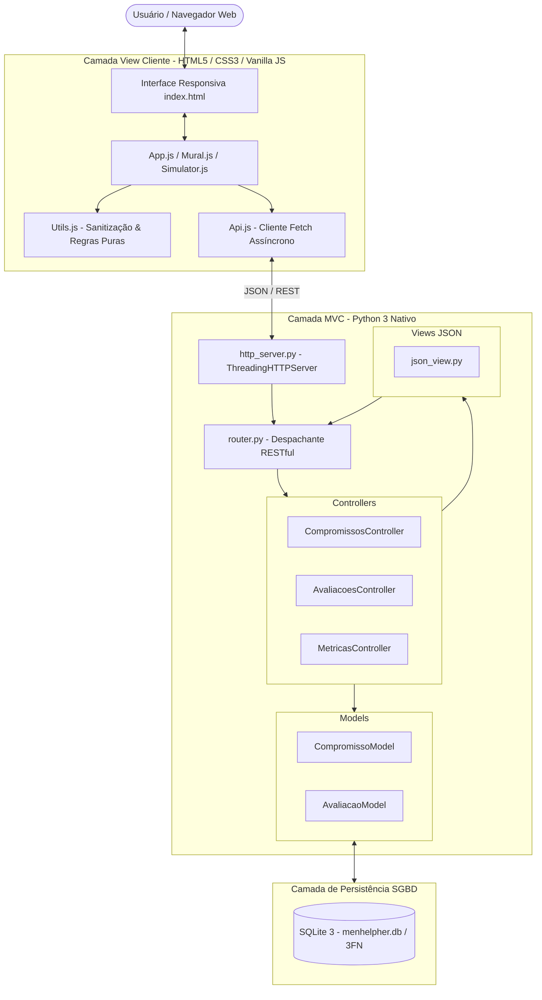

# MenHelpHer / EquiTech ODS 5
## Plataforma de Sensibilização e Equidade de Gênero na Engenharia de Software

[](https://github.com/engjuliocosta/MenHelpHer-ODS-5-engenharia-software/actions/workflows/ci.yml)
[-success?logo=github&logoColor=white)](https://engjuliocosta.github.io/MenHelpHer-ODS-5-engenharia-software/)


> **Projeto Integrado Transdisciplinar (PIT I e PIT II)**  
> **Instituição de Ensino Superior:** Universidade Cruzeiro do Sul (Cruzeiro do Sul Virtual)  
> **Curso:** Bacharelado em Engenharia de Software  
> **Autor / Discente:** Julio Costa  
> **Ciclo de Desenvolvimento:** Iniciado em **PIT I** (Concepção, Design Thinking e Prototipação) e Concluído em **PIT II** (Arquitetura MVC, SGBD Relacional, 112 Testes Automatizados com 100% de Cobertura Backend e Conteinerização Docker)  
> **Tema Central:** ODS 5 da ONU (Metas 5.1, 5.5 e 5.b da Agenda 2030)  
> **Alinhamentos:** Programa Meninas Digitais (SBC), Movimento HeForShe / ElesPorElas (ONU Mulheres) e Código de Ética Profissional ACM/IEEE  
> 🌐 **Demonstração Online (GitHub Pages):** [https://engjuliocosta.github.io/MenHelpHer-ODS-5-engenharia-software/](https://engjuliocosta.github.io/MenHelpHer-ODS-5-engenharia-software/)

---

## ⚡ Guia Rápido de Execução para Avaliadores e Testadores

A aplicação pode ser executada de **três formas simples e dinâmicas**, projetadas para que avaliadores acadêmicos e dublês de usuário testem o sistema imediatamente:

```
┌────────────────────────────────────────────────────────────────────────────────────────┐
│                        ESCOLHA O MODO DE EXECUÇÃO DESEJADO                            │
├────────────────────────────────────────────────────────────────────────────────────────┤
│  1. SCRIPT UNIVERSAL (Recomendado):  python iniciar_ambiente_testador.py              │
│     → Funciona no Windows, Linux e Mac. Baixa o projeto caso necessário, sobe o       │
│       Docker (ou modo nativo se não tiver Docker), valida a saúde e abre o navegador.  │
│                                                                                        │
│  2. CONTÊINER DOCKER DIRETO:                                                          │
│     → Linux/macOS: ./executar_container.sh    |  Windows: executar_container.bat       │
│                                                                                        │
│  3. PYTHON NATIVO (Zero Dependências Externas):                                        │
│     → python3 server.py  (depois acesse http://localhost:8000)                         │
└────────────────────────────────────────────────────────────────────────────────────────┘
```

### 🌟 Opção 1: Script Inicializador Universal (Recomendado - 1 Comando)
Ideal para avaliadores que receberam o script por e-mail, Drive ou baixaram avulso. Utiliza apenas a biblioteca padrão do Python e gerencia todo o ambiente:

```bash
# No Windows:
python iniciar_ambiente_testador.py

# No Linux ou macOS:
python3 iniciar_ambiente_testador.py
```
> O script detecta seu SO, verifica/baixa os arquivos do projeto, inicia o Docker (com fallback automático para Python nativo caso você não tenha Docker), aguarda o *healthcheck* e **abre o navegador automaticamente em [http://localhost:8000](http://localhost:8000)** com menu interativo.  
> 📖 *Documentação completa:* [`docs/pit2/DOCUMENTACAO_SCRIPT_GERADOR_UNIVERSAL.md`](docs/pit2/DOCUMENTACAO_SCRIPT_GERADOR_UNIVERSAL.md) | Versão texto: [`DOCUMENTACAO_SCRIPT_GERADOR_UNIVERSAL.txt`](DOCUMENTACAO_SCRIPT_GERADOR_UNIVERSAL.txt).

### 🐳 Opção 2: Scripts Dinâmicos de Contêiner Docker
Para quem já tem o repositório clonado e possui Docker instalado:
- **No Linux / macOS / WSL:**
  ```bash
  ./executar_container.sh
  ```
- **No Windows:**
  Dê um duplo clique no arquivo [`executar_container.bat`](executar_container.bat) ou execute via Prompt de Comando.
> 📖 *Guia passo a passo com critérios de aceite para testadores:* [`docs/pit2/GUIA_TESTADORES_CONTAINER.md`](docs/pit2/GUIA_TESTADORES_CONTAINER.md).

### 🚀 Opção 3: Execução Local Direta (Python Puro, sem Docker)
```bash
python3 server.py
```
*(No Windows, utilize `python server.py`).*  
Acesse em: 👉 **[http://localhost:8000](http://localhost:8000)**

---

## 🌟 Visão Geral do Projeto

A **MenHelpHer (EquiTech ODS 5)** é uma aplicação web completa, acessível (WCAG 2.1) e orientada a dados, desenvolvida para combater a sub-representação feminina e os vieses inconscientes na Engenharia de Software e no setor de TI.

O projeto une rigor científico, responsabilidade social e excelência técnica, demonstrando na prática que o desenvolvimento de software é uma **atividade sociotécnica** indissociável da ética profissional e da justiça de gênero.

---

## 🏛️ Evolução Acadêmica: Do PIT I ao PIT II

| Dimensão de Engenharia | Situação no PIT I | Consolidação no PIT II |
|---|---|---|
| **Padrão Arquitetural** | Script monolítico procedural | **Model-View-Controller (MVC)** estrito e desacoplado |
| **Persistência de Dados** | Arquivos estáticos JSON simples | **SGBD Relacional SQLite 3** em 3ª Forma Normal (3FN), com DDL padronizado, PKs, FKs e restrições `CHECK` |
| **Garantia de Qualidade** | Testes manuais pontuais | **112 testes automatizados** com **100% de cobertura no backend** (unitários, integração REST, ponta-a-ponta HTTP e integridade) |
| **Conteinerização** | Não conteinerizado | **Dockerfile otimizado e docker-compose** com usuário seguro não-root (`appuser`) e healthcheck ativo |
| **Validação com Usuários** | Avaliação preliminar de conceito | **Validação com dublês de usuário (pares)** com laudos padronizados e matriz de rastreabilidade |
| **Segurança & Resiliência** | Validação básica de formulários | **Higienização anti-XSS**, proteção contra payloads abusivos (HTTP 413) e modo offline com fallback |
| **Acessibilidade Digital** | Recursos visuais básicos | **WCAG 2.1:** WAI-ARIA Tabs com navegação por setas, skip link, leitor nativo e persistência de preferências |

---

## 🚀 Módulos da Aplicação

### 1. 📊 Painel de Indicadores e Dados (Data Dashboard)
- Curadoria de indicadores oficiais da **SBC (Sociedade Brasileira de Computação)**, **IPEA (Retrato das Desigualdades)**, **Inep/MEC** e **ONU Mulheres**.
- **Métricas Chave**:
  - `15,2%`: Participação feminina em cursos de graduação em computação no Brasil (queda de 70% em relação aos anos 80).
  - `17,8%`: Mulheres no mercado de trabalho em funções técnicas de TI.
  - `13,6%`: Mulheres em posições de liderança técnica (CTOs, VPs de Engenharia, Tech Leads).
  - `21,4%`: Disparidade salarial média em cargos equivalentes de desenvolvimento.
- Visualização dinâmica do **Funil de Evasão e Liderança em Computação**.
- Metas **5.1**, **5.5** e **5.b** da Agenda 2030 traduzidas para a prática diária de squads ágeis.

### 2. 🎮 Simulador Gamificado de Vieses Inconscientes
- 5 cenários práticos e realistas contextualizados na rotina de equipes de tecnologia:
  1. **Code Review com Exigências Desproporcionais** (*Prove-it-again bias* no GitHub/GitLab).
  2. **Daily Scrum e 'Manterrupting' em Arquitetura** (Interrupções de fala e apropriação de ideias).
  3. **Entrevista Técnica & Viés de Ajuste Cultural** (Perguntas invasivas e discriminação familiar).
  4. **Viés Algorítmico & Ética em IA no Hackathon** (*Sampling bias* e algoritmos discriminatórios).
  5. **Avaliação 360 & Duplo Padrão de Liderança** (Julgamento comportamental e promoção para Staff Engineer).
- Feedback imediato com pontuação, explicação fundamentada no **Código ACM/IEEE** e dicas práticas para aliados da equidade.

### 3. 🤝 Mural Digital de Compromissos (Inspirado no HeForShe / ElesPorElas)
- Registro público e voluntário de compromissos individuais por discentes, docentes e profissionais de TI.
- Categorias de compromisso:
  - *Revisão de Código Inclusiva e Respeitosa*
  - *Combate ao Manterrupting em Reuniões*
  - *Mentoria Ativa para Mulheres em Computação*
  - *Fomento a Lideranças Femininas*
  - *Defesa de Paridade Salarial e Oportunidades Justas*
- Feed dinâmico com contadores de apoio (curtidas), filtros por perfil e persistência relacional com fallback.

### 4. 📚 Pioneiras Históricas & Checklist para Squads
- Biografias e legados de **Ada Lovelace**, **Margaret Hamilton**, **Grace Hopper** e da cientista brasileira **Claudia Bauzer Medeiros**.
- **Checklist de 6 Boas Práticas** para squads e laboratórios acadêmicos inclusivos.
- Conexões diretas com o **Programa Meninas Digitais (SBC)** e **HeForShe**.

### 5. 📝 Avaliação de Impacto da Campanha & Métricas em Tempo Real
- Formulário eletrônico integrado para mensurar clareza, relevância e absorção de conceitos.
- Painel de **Métricas Consolidadas** que calcula dinamicamente as médias avaliativas através do Controller do backend.

---

## ♿ Recursos de Acessibilidade (WCAG 2.1)

- **Skip Link:** Atalho no topo para usuários de teclado saltarem diretamente para o conteúdo principal.
- **Modo Alto Contraste:** Adaptado para pessoas com baixa visão ou fotossensibilidade (persistido no navegador).
- **Redimensionamento Dinâmico de Fonte (`A+`, `A`, `A-`)** persistido entre sessões.
- **Leitor de Tela Nativo:** Síntese de voz em português via *Web Speech API*.
- **WAI-ARIA Tabs:** Navegação entre abas por setas do teclado (`ArrowLeft`, `ArrowRight`, `Home`, `End`) com *roving tabindex*.
- **Alternador de Tema:** Modo Escuro (*Dark Mode*) e Modo Claro (*Light Mode*).

---

## 🛠️ Tecnologias e Arquitetura (Padrão MVC)



- **Frontend**: HTML5 Semântico, Vanilla CSS Moderno (Design Tokens, Glassmorphism, CSS Custom Properties), JavaScript ES6+ Modular (sem dependência de frameworks ou empacotadores).
- **Backend**: Python 3 nativo (`ThreadingHTTPServer`, rotas RESTful JSON, modelos de validação, controllers desacoplados).
- **Banco de Dados**: SQLite 3 com modelo relacional normalizado (3FN), DDL padronizado ANSI-SQL, chaves primárias, estrangeiras e constraints `CHECK`.
- **Contêiner**: Dockerfile enxuto com `python:3.12-slim`, Docker Compose e scripts de automação.

---

## 📁 Estrutura de Diretórios

```
pit-1_2/
├── iniciar_ambiente_testador.py         # Inicializador universal multiplataforma (Windows/Linux/Mac)
├── executar_container.sh                # Script dinâmico de contêiner para Linux/macOS
├── executar_container.bat               # Script dinâmico de contêiner para Windows
├── run_tests.sh                         # Script facilitador de execução da suíte de testes
├── server.py                            # Ponto de entrada nativo do servidor Python
├── Dockerfile                           # Especificação do contêiner Docker seguro (appuser)
├── docker-compose.yml                   # Orquestração do serviço e volume do SQLite
├── pytest.ini                           # Configurações padronizadas de testes do Pytest
├── requirements.txt                     # Dependências para execução de testes e cobertura
├── DOCUMENTACAO_SCRIPT_GERADOR_UNIVERSAL.txt # Versão texto da documentação para avaliadores
├── backend/                             # Camada Back-end (Padrão MVC em Python)
│   ├── config.py                        # Configurações centrais e variáveis de ambiente
│   ├── database.py                      # DAO e gerenciamento de transações SQLite
│   ├── errors.py                        # Exceções de domínio (400, 404, 405, 413)
│   ├── router.py                        # Mapeamento de endpoints RESTful para controllers
│   ├── http_server.py                   # Servidor multithread com cabeçalhos de segurança
│   ├── models/                          # Camada Model (Regras de negócio e SQL)
│   │   ├── compromisso.py
│   │   └── avaliacao.py
│   ├── controllers/                     # Camada Controller (Orquestração de fluxo)
│   │   ├── compromissos_controller.py
│   │   ├── avaliacoes_controller.py
│   │   └── metricas_controller.py
│   └── views/                           # Camada View (Serialização JSON)
│       └── json_view.py
├── frontend/                            # Camada Front-end (Interface do Usuário)
│   ├── index.html                       # Página web acessível principal
│   ├── css/
│   │   ├── main.css                     # Tokens, acessibilidade e temas
│   │   ├── dashboard.css                # Estilos dos KPIs e funil
│   │   ├── simulator.css                # Estilos da gamificação
│   │   └── mural.css                    # Estilos do mural e métricas
│   └── js/
│       ├── utils.js                     # Funções puras e higienização anti-XSS
│       ├── api.js                       # Cliente HTTP assíncrono (Fetch API)
│       ├── data.js                      # Base de dados estatísticos oficiais
│       ├── dashboard.js                 # Renderização de gráficos e KPIs
│       ├── simulator.js                 # Lógica do simulador de vieses
│       ├── mural.js                     # Lógica do mural e avaliação
│       └── app.js                       # Controlador geral e WCAG
├── database/                            # Scripts SQL e Persistência SGBD
│   ├── schema.sql                       # DDL físico do banco relacional (3FN)
│   ├── seed_dominios.sql                # Catálogos de papéis e tipos de compromisso
│   ├── seed_demo.sql                    # Carga inicial pedagógica
│   └── menhelpher.db                    # Banco de dados SQLite ativo (gerado)
├── tests/                               # Suíte com 112 Testes Automatizados (100% Cobertura Backend)
│   ├── helpers.py                       # Fixture com banco isolado temporário
│   ├── test_models.py                   # Testes unitários da camada Model
│   ├── test_api_router.py               # Testes do roteador e controllers
│   ├── test_http_integration.py         # Testes ponta-a-ponta com servidor HTTP real
│   ├── test_frontend_estrutura.py       # Testes estáticos de integridade HTML/ARIA
│   ├── test_unit_controllers.py         # Testes unitários isolados dos controllers (com mocks)
│   ├── test_unit_views.py               # Testes unitários das views de serialização JSON
│   ├── test_unit_config_errors.py       # Testes unitários de configurações e erros HTTP
│   ├── test_unit_database.py            # Testes unitários transacionais do DAO SQLite
│   ├── test_unit_http_server.py         # Testes unitários do manipulador HTTP e cabeçalhos
│   ├── test_unit_server.py              # Testes unitários do ponto de entrada server.py
│   ├── test_unit_iniciar_ambiente_testador.py # Testes do script inicializador universal
│   └── frontend/
│       └── runner.html                  # Executador de testes unitários no navegador
└── docs/                                # Documentações Acadêmicas Completas
    ├── pit1/
    │   ├── RELATORIO_PIT_I.md           # Relatório acadêmico original do PIT I
    │   └── CARTAZ_CAMPANHA_DIVULGACAO.md# Cartaz de divulgação nos laboratórios
    └── pit2/
        ├── RELATORIO_PIT_II.md          # Relatório técnico consolidado do PIT II
        ├── MANUAL_DE_USO_E_INSTALACAO.md# Manual detalhado de instalação e uso
        ├── GUIA_TESTADORES_CONTAINER.md # Guia de testes e critérios de aceite via contêiner
        ├── DOCUMENTACAO_SCRIPT_GERADOR_UNIVERSAL.md # Documentação do inicializador universal
        └── ROTEIRO_GRAVACAO_VIDEO_5MIN.md# Roteiro cronometrado para o vídeo narrado
```

---

## 🧪 Execução dos Testes Automatizados

O projeto conta com **112 testes automatizados** cobrindo regras de negócio, camada Model, Controllers, Views, Router, servidor HTTP, banco de dados relacional e integridade de interface, alcançando **100% de cobertura de código no backend**.

### Execução via módulo padrão `unittest` (Zero dependências externas):
```bash
python3 -m unittest discover -s tests -t .
```

Resultado esperado:
```text
Ran 112 tests in ~14s
OK
```

### Execução via `pytest` com relatório de cobertura (opcional):
```bash
pytest --cov=backend --cov-report=term-missing
```

Resultado esperado:
```text
TOTAL: 331 statements, 0 missing, 100% coverage
================ 112 passed in ~14s ================
```

### Execução via script auxiliar automatizado:
```bash
./run_tests.sh
```

Para executar a suíte de testes unitários do front-end no navegador (JavaScript com asserções em tempo real), abra o arquivo `tests/frontend/runner.html` diretamente no seu navegador.

---

## 📜 Informações Acadêmicas

- **Discente:** Julio Costa
- **Curso:** Bacharelado em Engenharia de Software
- **Instituição:** Universidade Cruzeiro do Sul (Cruzeiro do Sul Virtual)
- **Disciplinas:** Projeto Integrado Transdisciplinar I e II (PIT I e PIT II)
- **Ano de Conclusão:** 2026
- **Licença:** MIT (Educacional e Aberta)
