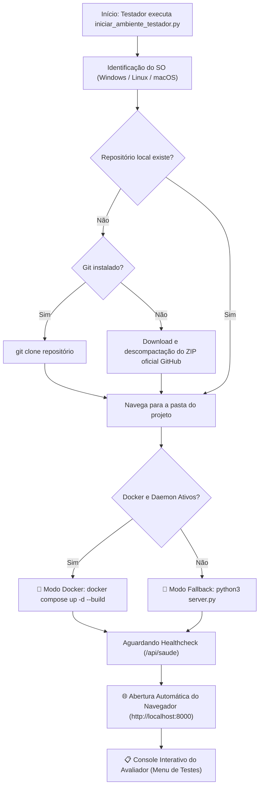

# 🚀 Documentação Técnica: Script Inicializador Universal (`iniciar_ambiente_testador.py`)
## MenHelpHer / EquiTech ODS 5 — Plataforma de Equidade de Gênero na Engenharia de Software

> **Instituição de Ensino Superior:** Universidade Cruzeiro do Sul (Cruzeiro do Sul Virtual)  
> **Curso:** Bacharelado em Engenharia de Software  
> **Discente / Autor:** Julio Costa  
> **Projeto:** Projeto Integrado Transdisciplinar (PIT I e PIT II)  
> **Artefato:** Script Autônomo Multiplataforma `iniciar_ambiente_testador.py`

---

## 💡 1. Visão Geral e Propósito

O [`iniciar_ambiente_testador.py`](../../iniciar_ambiente_testador.py) é um **script autônomo em Python puro (sem nenhuma dependência externa)** desenvolvido para resolver o desafio de distribuição da aplicação para avaliadores, professores e dublês de usuário (testadores de pares).

### O Problema Resolvido:
Em avaliações acadêmicas de Engenharia de Software, é comum que testadores utilizem diferentes sistemas operacionais (**Windows, Linux ou macOS**), tenham ou não o Docker instalado, e muitas vezes não possuam familiaridade com Git ou criação de ambientes virtuais (`venv`). 

### A Solução:
Um único arquivo executável em Python que pode ser enviado avulso por **e-mail, Google Drive ou WhatsApp**. Ao ser executado em qualquer pasta vazia, ele identifica o ambiente, baixa automaticamente o repositório completo, sobe a aplicação (via contêiner Docker ou via Python nativo como fallback), monitora o status de saúde e abre o navegador automaticamente.

---

## 🛠️ 2. Arquitetura e Ciclo de Vida do Script



---

## ⚙️ 3. Funcionamento Dinâmico Detalhado

### 3.1 Detecção de Sistema Operacional (`platform`)
O script utiliza os módulos nativos `platform` e `os` para identificar a plataforma do avaliador:
- **Windows:** Configura comandos de terminal compatíveis (`cls`, `webbrowser`, gerenciamento de subprocessos).
- **Linux:** Utiliza `clear`, `xdg-open` e gerenciamento de sinais `SIGTERM`/`SIGINT`.
- **macOS (Darwin):** Integração com `open` e bibliotecas nativas BSD.

### 3.2 Download Autônomo do Repositório (Zero Pré-requisitos de Git)
Se o avaliador salvar o script em uma pasta vazia e executá-lo:
1. O script tenta executar `git clone https://github.com/engjuliocosta/MenHelpHer-ODS-5-engenharia-software.git`.
2. Caso o avaliador **não tenha Git instalado**, o script utiliza o módulo nativo `urllib.request` para baixar o arquivo `main.zip` oficial do GitHub, descompacta com `zipfile` e posiciona o ambiente de trabalho automaticamente.

### 3.3 Estratégia Resiliente de Execução (Dual-Engine: Docker vs. Nativo)
- **Modo Preferencial (Contêiner Docker):** Se o Docker estiver instalado e ativo, o script monta o contêiner isolado (`docker compose up -d --build`), assegurando isolamento total.
- **Modo Fallback Inteligente (Python Puro):** Se a máquina do testador não tiver Docker, o script inicializa imediatamente o servidor em modo nativo através de `server.py`. **O avaliador nunca fica impedido de testar.**

### 3.4 Monitoramento de Saúde (*Healthcheck Liveness*)
Antes de abrir o navegador, o script realiza requisições sucessivas à rota `/api/saude` até obter confirmação `HTTP 200 (OK)` da conexão com o banco relacional SQLite 3.

### 3.5 Abertura do Navegador e Console Interativo
Com a aplicação ativa, o navegador padrão é aberto na URL **`http://localhost:8000`** e um menu interativo é mantido no terminal:
- `[1]` Reabrir a interface no navegador.
- `[2]` **Executar a suíte de 106 testes unitários com relatório de cobertura**.
- `[3]` Monitorar logs de requisições em tempo real.
- `[4]` Resetar o banco de dados para os valores de demonstração.
- `[5]` Encerrar o servidor ou contêiner de forma limpa.

---

## ✉️ 4. Modelo de Mensagem / E-mail para Envio aos Avaliadores

Você pode copiar e colar o texto abaixo ao compartilhar o arquivo com seus colegas ou professores avaliadores:

```text
Assunto: [PIT II - Engenharia de Software] Convite para Teste da Aplicação MenHelpHer (ODS 5)

Olá!

Como parte da avaliação da disciplina Projeto Integrado Transdisciplinar II (PIT II) do curso de Bacharelado em Engenharia de Software da Universidade Cruzeiro do Sul, convido você a testar a plataforma MenHelpHer (EquiTech ODS 5).

Para testar, você NÃO precisa clonar manualmente o repositório nem configurar bancos de dados. Basta seguir estes passos simples:

1. Baixe o arquivo anexo: iniciar_ambiente_testador.py
2. Abra o terminal ou prompt de comando na pasta onde salvou o arquivo.
3. Execute o comando:
   - No Windows: python iniciar_ambiente_testador.py
   - No Linux ou Mac: python3 iniciar_ambiente_testador.py

O script irá:
- Baixar os arquivos necessários do projeto automaticamente (caso ainda não estejam baixados).
- Levantar o contêiner Docker (ou modo nativo Python caso não tenha Docker).
- Abrir automaticamente a aplicação no seu navegador padrão (http://localhost:8000).
- Exibir um menu para você executar os 106 testes automatizados e validar o sistema.

Agradeço imensamente seu feedback e sua contribuição para o projeto!

Atenciosamente,
Julio Costa
Estudante de Engenharia de Software - Universidade Cruzeiro do Sul
```

---

## 🧪 5. Validação Automatizada do Script

O próprio script `iniciar_ambiente_testador.py` possui testes unitários dedicados em [`tests/test_unit_iniciar_ambiente_testador.py`](../../tests/test_unit_iniciar_ambiente_testador.py), cobrindo:
- Detecção de binários do sistema operacional (`shutil.which`).
- Detecção de daemon ativo do Docker.
- Verificação de sucesso e tratamento de falha no endpoint de saúde (`/api/saude`).
- Disparo de abertura do navegador padrão.

---

## 🏛️ 6. Informações Acadêmicas Oficiais
- **Instituição:** Universidade Cruzeiro do Sul (Cruzeiro do Sul Virtual)
- **Discente:** Julio Costa
- **Curso:** Bacharelado em Engenharia de Software
- **Disciplinas:** Projeto Integrado Transdisciplinar I e II (PIT I e PIT II)
- **Ano de Conclusão:** 2026
