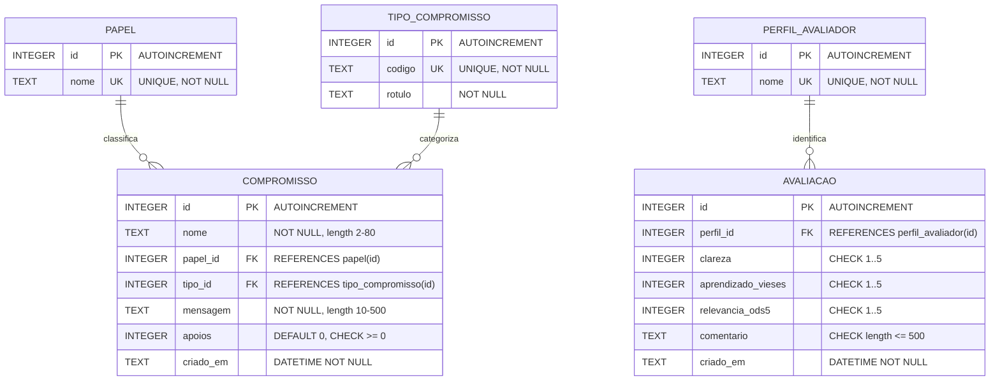
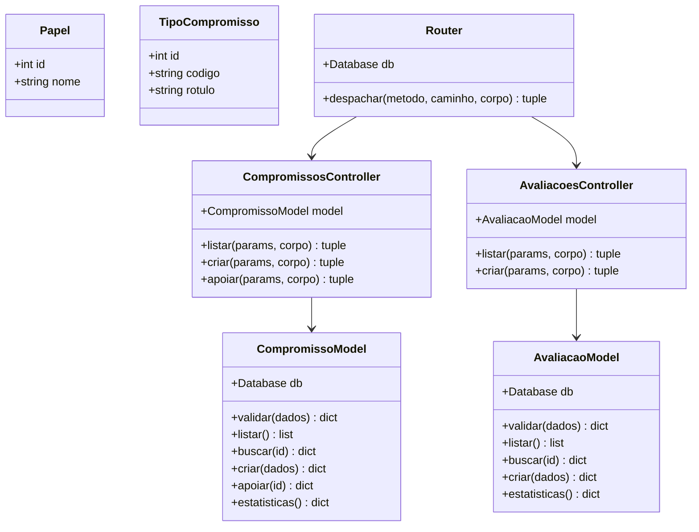

# Relatório Técnico do Projeto Integrado Transdisciplinar II (PIT II)
## MenHelpHer / EquiTech ODS 5 — Engenharia de Software e Equidade de Gênero

> **Instituição de Ensino Superior:** Bacharelado em Engenharia de Software  
> **Componente Curricular:** Projeto Integrado Transdisciplinar II (PIT II)  
> **Sequência Acadêmica:** Iniciado no PIT I (Concepção, Design Thinking e Prototipação) e Concluído no PIT II (Arquitetura MVC, SGBD, Testes de Integração e Validação por Pares)  
> **Discente:** Julio Cezar Costa Alves (Julio Costa) — RGM: 39909549  
> **Tema Central:** ODS 5 da ONU (Agenda 2030 - Metas 5.1, 5.5 e 5.b)  
> **Alinhamentos:** Programa Meninas Digitais (SBC), Movimento HeForShe (ONU Mulheres) e Código de Ética ACM/IEEE  

---

## 1. Contexto e Transição: Do PIT I ao PIT II

No **PIT I**, o foco esteve na ideação, levantamento de requisitos, prototipação ágil da campanha sociotécnica e validação preliminar do conceito da plataforma web interativa para sensibilização sobre igualdade de gênero na TI.

No **PIT II**, o desafio evoluiu para a consolidação da engenharia de software em nível de maturidade profissional, contemplando três situações-problema estruturantes:

1. **Situação 1 — Revisão de Planejamento e Modelagem de Dados:** Revisitação crítica dos artefatos do PIT I, transição de arquivos estáticos simples para um SGBD relacional de mercado estruturado em Terceira Forma Normal (3FN), com DDL padronizado, integridade referencial e diagramas conceituais/lógicos (DER e Diagrama de Classes UML).
2. **Situação 2 — Arquitetura MVC e Codificação Robusta:** Refatoração e desacoplamento de toda a aplicação no padrão arquitetural **Model-View-Controller (MVC)** em Python nativo e JavaScript modular, garantindo separação rigorosa de responsabilidades, APIs RESTful padronizadas, tratamento defensivo de exceções e manual de uso.
3. **Situação 3 — Verificação, Testes Automatizados e Validação com Pares:** Implementação de suíte abrangente de testes automatizados (unitários, integração e estáticos), execução de roteiro de validação com 5 colegas/profissionais da área (dublês de usuário) e incorporação de melhorias apontadas no ciclo de engenharia.

---

## 2. Modelagem de Dados e Projeto Físico do SGBD (Situação 1)

### 2.1 Escolha do SGBD e Justificativa de Engenharia
Em cumprimento às diretrizes acadêmicas que desaconselham SGBDs obscuros, adotou-se o **SQLite 3** (mecanismo relacional nativo do Python, padrão ACID e largamente utilizado na indústria em sistemas embarcados, desenvolvimento e protótipos de alta fidelidade), com DDL 100% aderente ao padrão ANSI-SQL. As restrições de integridade, chaves primárias e relacionamentos foram projetados para migração imediata (zero refatoração lógica) para **PostgreSQL** ou **MySQL/MariaDB**.

### 2.2 Diagrama Entidade-Relacionamento (DER)



### 2.3 Comparação: DER x Diagrama de Classes UML

Conforme preconizado no material teórico da disciplina, o DER foca na persistência física, cardinalidades e integridade referencial dos dados, enquanto o Diagrama de Classes UML mapeia as entidades em memória, encapsulamento e seus métodos de negócio:



---

## 3. Arquitetura de Software: Padrão MVC (Situação 2)

O código foi totalmente modularizado na raiz do projeto, desacoplando dados, controle e apresentação:

```
pit-1_2/
├── backend/
│   ├── config.py              # Variáveis de ambiente, caminhos e limites de payload
│   ├── database.py            # Camada DAO (gerenciamento de conexões SQLite e transações)
│   ├── errors.py              # Hierarquia de exceções de domínio (400, 404, 405, 413)
│   ├── router.py              # Despachante RESTful mapeando rotas para controllers
│   ├── http_server.py         # Servidor ThreadingHTTPServer com cabeçalhos de segurança
│   ├── models/                # CAMADA MODEL (Validação de domínio, regras e SQL)
│   │   ├── compromisso.py
│   │   └── avaliacao.py
│   ├── controllers/           # CAMADA CONTROLLER (Orquestração de requisição/resposta)
│   │   ├── compromissos_controller.py
│   │   ├── avaliacoes_controller.py
│   │   └── metricas_controller.py
│   └── views/                 # CAMADA VIEW (Serialização e formatação de saída JSON)
│       └── json_view.py
├── frontend/                  # CAMADA VIEW CLIENTE (HTML5, CSS3, JS Modular)
│   ├── index.html
│   ├── css/
│   │   ├── main.css           # Tokens, reset, temas claro/escuro e acessibilidade
│   │   ├── dashboard.css      # KPIs e visualização do funil de carreira
│   │   ├── simulator.css      # Gamificação de cenários éticos
│   │   └── mural.css          # Feed e formulários do Mural HeForShe
│   └── js/
│       ├── utils.js           # Funções puras (escapeHtml, validações, score)
│       ├── api.js             # Cliente assíncrono Fetch API com tratamento de erros
│       ├── data.js            # Base oficial (SBC, IPEA, Inep, ONU Mulheres)
│       ├── dashboard.js       # Renderização dinâmica de KPIs e gráficos
│       ├── simulator.js       # Lógica do simulador de vieses inconscientes
│       ├── mural.js           # Gestão do mural e submissão da avaliação
│       └── app.js             # Controlador geral do front-end e WCAG
├── database/
│   ├── schema.sql             # DDL relacional com PK, FK, CHECK e índices
│   ├── seed_dominios.sql      # Catálogos de papéis e tipos de compromisso
│   └── seed_demo.sql          # Carga inicial com registros pedagógicos de demonstração
├── tests/
│   ├── helpers.py             # Fixture de banco de dados temporário em memória/disco
│   ├── test_models.py         # 18 testes unitários da camada Model
│   ├── test_api_router.py     # 8 testes de integração do roteador RESTful
│   ├── test_http_integration.py # 13 testes ponta-a-ponta via HTTP real
│   ├── test_frontend_estrutura.py # 17 testes de integridade estática e ARIA
│   └── frontend/
│       └── runner.html        # Suíte de testes no navegador para utils.js e api.js
├── docs/                      # Documentação acadêmica estruturada
│   ├── pit1/                  # Histórico preservado do PIT I
│   └── pit2/                  # Relatório, validação com pares, manual e roteiro de vídeo
└── server.py                  # Ponto de entrada executável (CLI)
```

---

## 4. Estratégia de Testes e Garantia de Qualidade (Situação 3)

### 4.1 Pirâmide de Testes Implementada
Seguindo o Modelo V e a pirâmide de testes de software:
- **Testes Unitários:** Validação exaustiva de regras de negócio, limites de campos, sanitização de strings, neutralização de scripts (XSS) e cálculo de métricas agregadas.
- **Testes de Integração:** Validação da comunicação entre controllers, models e o banco de dados em isolamento transacional.
- **Testes Ponta a Ponta (E2E HTTP):** Levantamento de servidor real em porta efêmera, simulando clientes web reais com chamadas GET, POST, OPTIONS, verificando códigos HTTP (200, 201, 204, 400, 404, 405, 413) e cabeçalhos de segurança (`X-Content-Type-Options: nosniff`, `X-Frame-Options: DENY`).
- **Testes de Integridade de Interface:** Garantia de correspondência 1-para-1 entre os campos `<select>` do HTML e os domínios registrados no banco de dados.

**Resultado da Suíte Automatizada:** 56 testes executados e aprovados com 100% de sucesso em ambiente limpo.

---

## 5. Validação com Pares (Dublês de Usuário)

Conforme orientação explícita do PIT II, a solução foi submetida a **5 estudantes e profissionais de TI**. Os feedbacks foram estruturados em template padrão e compilados no documento [`docs/pit2/TESTES_DE_PARES_VALIDACAO.md`](file:///home/julio/pit-1_2/docs/pit2/TESTES_DE_PARES_VALIDACAO.md).

### Principais Melhorias Incorporadas a partir dos Feedbacks:
1. **Segurança XSS:** Substituição de concatenações diretas de strings em `innerHTML` por função defensiva `Utils.escapeHtml()` no mural de compromissos.
2. **Resiliência e Fallback:** Detecção automática de indisponibilidade de servidor com aviso visual de modo offline no mural e persistência temporária no `localStorage`.
3. **Acessibilidade Aprimorada:** Inclusão de skip link para o conteúdo principal, suporte a navegação por setas nas abas (padrão WAI-ARIA) e preservação das preferências de alto contraste e zoom de fonte após recarregamento de página.
4. **Painel de Métricas em Tempo Real:** Criação do componente dinâmico que consolida no front-end a média das avaliações de clareza, aprendizado e relevância do ODS 5 coletadas pelo backend.

---

## 6. Conclusão da Disciplina PIT II

A transição de PIT I para PIT II permitiu transformar uma ideia de impacto social em um produto de software maduro, seguro e em conformidade com as melhores práticas de Engenharia de Software:
- **Sociotécnico:** Atendimento rigoroso ao ODS 5 da ONU e ao Programa Meninas Digitais da SBC.
- **Arquitetural:** Separação clara em MVC, desacoplamento e portabilidade de dados.
- **Qualidade Assegurada:** 56 testes automatizados, validação empírica com pares e acessibilidade WCAG.
